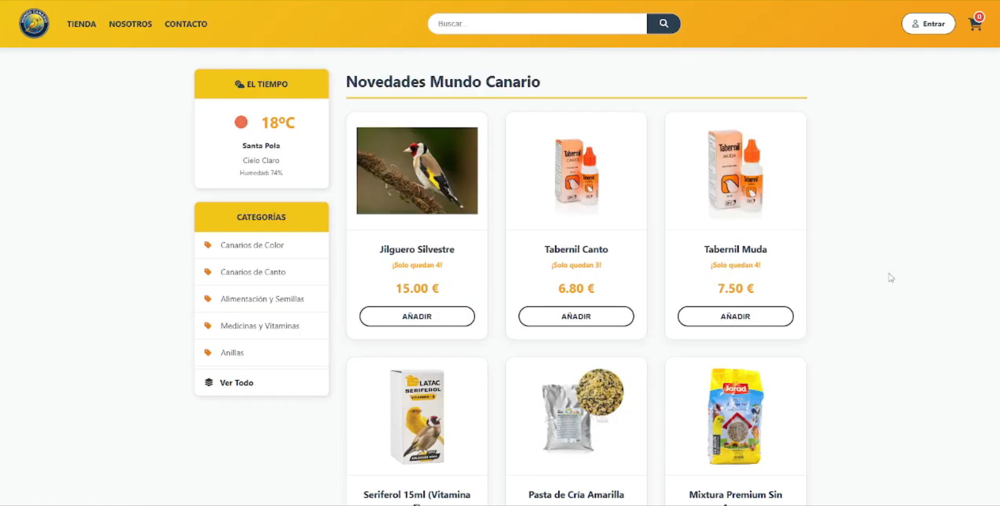
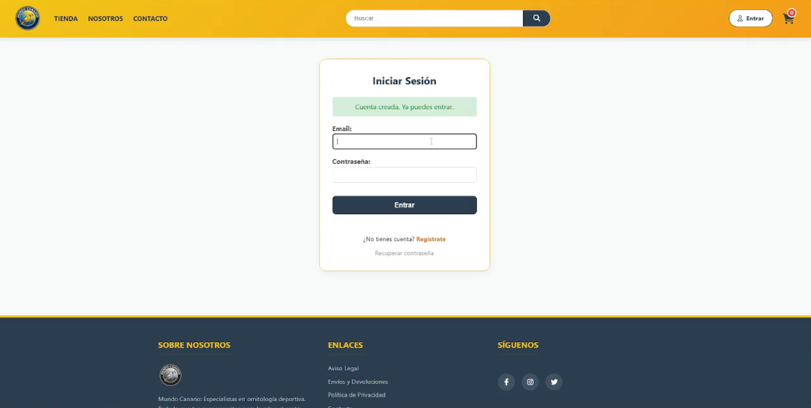
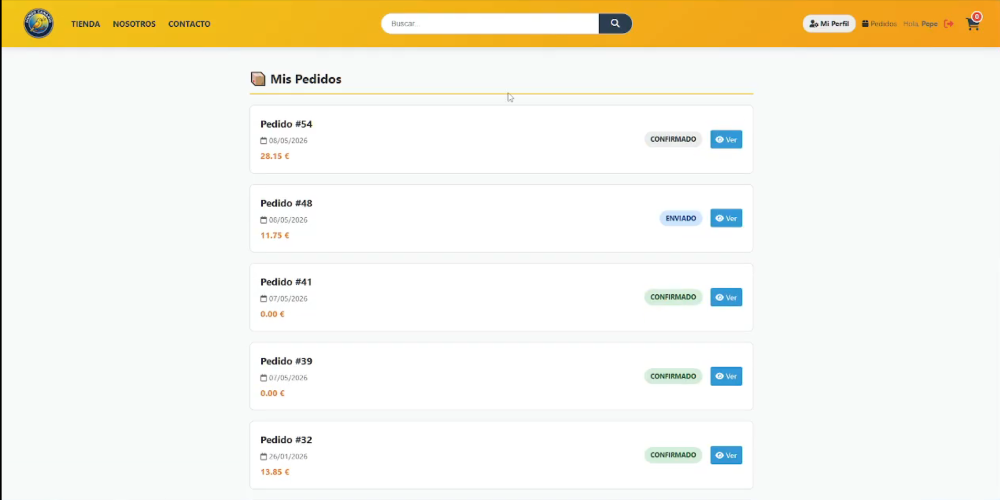
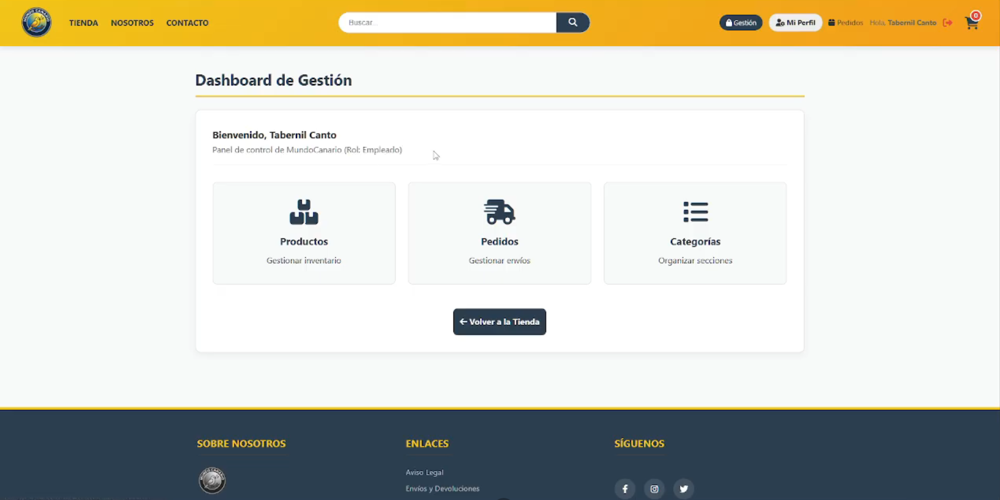
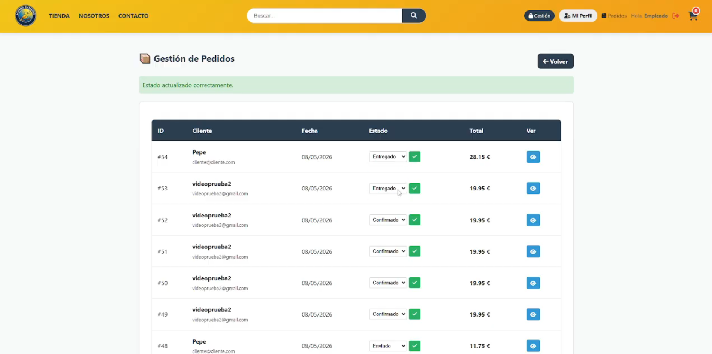

# Mundo Canario - Tienda Online

Este proyecto es una práctica académica realizada para el ciclo formativo de grado superior de **DAW (Desarrollo de Aplicaciones Web)**, concretamente para el módulo de **Desarrollo Web en Entorno Servidor (DWES)**.

## Descripción del proyecto

Mundo Canario es una tienda web temática orientada a la venta de aves y productos de ornitología. La aplicación cuenta con un catálogo de productos dinámico y conexión a base de datos MySQL para consultar información, gestionar el carrito de compra y tramitar pedidos.

## Capturas de la aplicación

### 1. Portada y Catálogo de Productos
Vista principal de la tienda con el catálogo de artículos, filtros por categoría, buscador y widget del tiempo.

### 2. Inicio de Sesión
Formulario de autenticación para clientes y personal de gestión con control de sesiones y mensajes de estado.

### 3. Mis Pedidos (Área de Cliente)
Listado donde los clientes pueden seguir el estado de sus compras (Confirmado, Enviado, Entregado).

### 4. Panel de Gestión (Dashboard)
Área interna accesible según el rol del usuario (Administrador o Empleado) para gestionar los recursos de la tienda.

### 5. Gestión de Pedidos
Panel de control para consultar los pedidos entrantes y actualizar su estado de envío en tiempo real.

## Tecnologías utilizadas

- **PHP** (con PDO y consultas preparadas)
- **MySQL / MariaDB**
- **HTML5 y CSS3**
- **JavaScript**
- Entorno local: **XAMPP / Apache**

## Pasos para probarlo en local

1. **Copiar el proyecto:**
   Colocar la carpeta `proyecto_tienda` dentro del directorio `htdocs` de XAMPP (por ejemplo: `C:\xampp\htdocs\proyecto_tienda`).

2. **Iniciar servicios:**
   Abrir el panel de control de XAMPP y activar los módulos **Apache** y **MySQL**.

3. **Importar la base de datos:**
   - Acceder a phpMyAdmin en el navegador (`http://localhost/phpmyadmin`).
   - Crear una base de datos nueva con el nombre `tienda_online`.
   - Seleccionar la base de datos e importar el archivo `base.sql` que se encuentra en la raíz del proyecto.

4. **Abrir la aplicación:**
   Entrar desde el navegador a la dirección:  
   `http://localhost/proyecto_tienda/`

### Cuentas de prueba

Para probar las funcionalidades de los distintos roles:

- **Administrador:**  
  Email: `admin@admin.com`  
  Contraseña: `admin123`

- **Cliente:**  
  Email: `cliente@cliente.com`  
  Contraseña: `1234`
